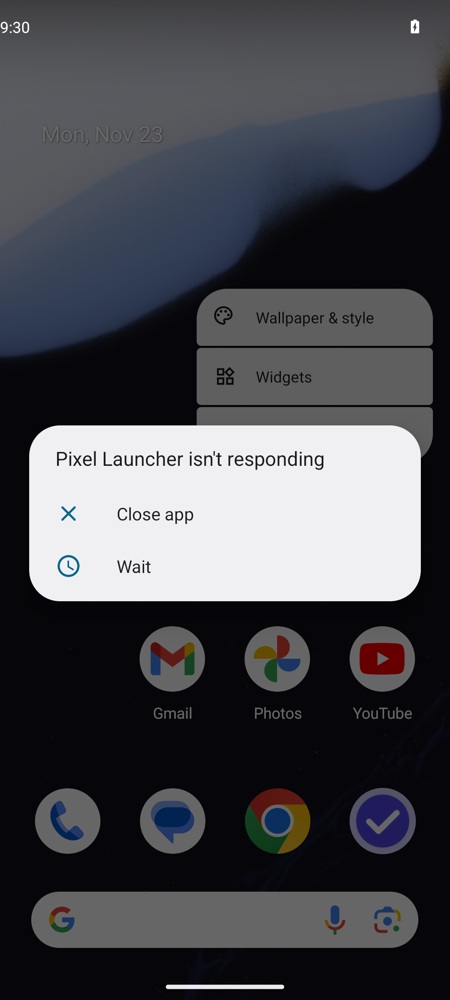
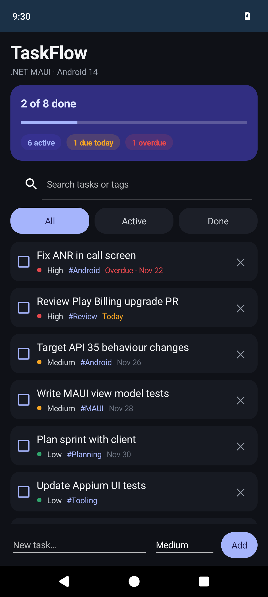
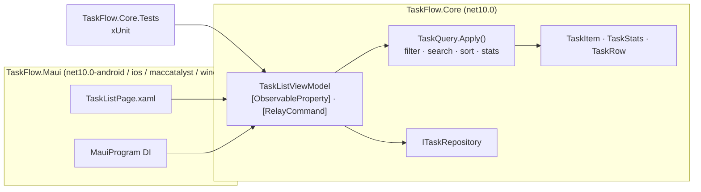

# TaskFlow · .NET MAUI

[](https://github.com/gayatripatel10091992/maui-taskflow/actions/workflows/ci.yml)


The same task manager as [kmp-taskflow](https://github.com/gayatripatel10091992/kmp-taskflow), built with **.NET MAUI and C#** using MVVM
(CommunityToolkit.Mvvm), dependency injection and compiled XAML bindings. It runs from one project on
Android, iOS, Windows and macOS.

## Screenshots

Captured by CI on a real Android emulator (API 34) from the release APK, in light and dark mode.

| Light | Dark |
|---|---|
|  |  |

## Architecture



- **The view model is UI-framework free.** It lives in a plain `net10.0` library, so 12 xUnit tests cover filtering, sorting, commands and `CanExecute` without a device.
- **Compiled bindings** (`x:DataType`) throughout, for build-time checking and better performance.
- **Light/dark theming** via `AppThemeBinding`.
- **Same behaviour as the Kotlin version:** `TaskQueryTests` mirrors the KMP `TaskListStateTest` case for case.

## Kotlin Multiplatform vs .NET MAUI

| | Kotlin Multiplatform | .NET MAUI |
|---|---|---|
| Shared code | Business logic (+ UI with Compose Multiplatform) | Logic **and** UI (XAML) |
| UI | Compose Multiplatform | XAML + native handlers |
| State | `StateFlow` + MVI actions | `INotifyPropertyChanged` + commands |
| Tests | `kotlin.test` on JVM, Android, iOS simulator | xUnit on .NET |
| Best fit | Teams with Android/Kotlin depth that want native per-platform UIs | Teams with C#/.NET depth that want one UI everywhere |

## Run it

```bash
dotnet workload install maui
dotnet build src/TaskFlow.Maui -f net10.0-android -t:Run      # Android device/emulator
dotnet build src/TaskFlow.Maui -f net10.0-windows10.0.19041.0  # Windows
dotnet test tests/TaskFlow.Core.Tests                         # unit tests
```

iOS and Mac Catalyst targets build on macOS with Xcode installed.

## CI

- **core-tests:** xUnit tests for the core library and view model.
- **android:** publishes a release APK, boots an API 34 emulator, captures light/dark screenshots and commits them.
- **windows:** builds the WinUI app on `windows-latest`.

## License

MIT © Gayatri Patel
